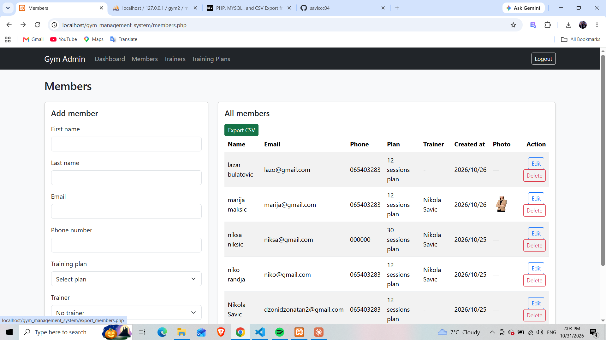

# Gym Management System

A simple admin panel for managing a gym, built with plain PHP and MySQL — no frameworks.

## Screenshots

<!--  -->

## Features

- **Admin login** with hashed passwords, session-based authentication and protected pages
- **Dashboard** with the number of members, trainers and training plans
- **Training plans** — list, add, delete (a plan that is used by members can't be deleted)
- **Trainers** — list, add, delete (their members are kept, just left without a trainer)
- **Members** — list, add, edit, delete
  - assign a training plan (required) and a trainer (optional)
  - upload a profile photo (JPG, PNG or WEBP, max 2 MB)
  - replacing or deleting a member also removes the old photo file
- **Access card** — generate a printable PDF card for each member (photo, plan, trainer, card number)
- **Export** — download all members as a CSV file (opens correctly in Excel, including č, ć, š, đ, ž)
- Server-side validation with clear error messages and preserved form input

## Tech stack

- PHP 8 (mysqli, prepared statements)
- MySQL / MariaDB
- Bootstrap 5
- [Dompdf](https://github.com/dompdf/dompdf) (installed with Composer) for PDF generation

## Security

- All queries use **prepared statements** (protection against SQL injection)
- All output is escaped with `htmlspecialchars()` (protection against XSS)
- Passwords are stored with `password_hash()` and checked with `password_verify()`
- Session ID is regenerated on login (`session_regenerate_id`)
- Uploaded files are checked by their **real MIME type** (`finfo`), not by extension,
  and saved under a random file name
- Delete actions use `POST` forms, not links

## Database

Four tables:

| Table            | Description                                                       |
| ---------------- | ----------------------------------------------------------------- |
| `admins`         | Admin accounts (username + hashed password)                       |
| `training_plans` | Available training plans                                          |
| `trainers`       | Gym trainers                                                      |
| `members`        | Gym members, linked to a plan (required) and a trainer (optional) |

Foreign key behaviour:

- `members.plan_id` → `ON DELETE RESTRICT` — a plan can't be deleted while members use it
- `members.trainer_id` → `ON DELETE SET NULL` — deleting a trainer leaves their members without a trainer

The full schema is in [`database.sql`](database.sql).

## Getting started

### Requirements

- [XAMPP](https://www.apachefriends.org/) (or any setup with PHP 8+ and MySQL/MariaDB)
- [Composer](https://getcomposer.org/)
- PHP extensions `gd`, `mbstring` and `zip` enabled in `php.ini`

### Setup

1. Clone the repository into your web root (e.g. `C:\xampp\htdocs\`):

   ```bash
   git clone https://github.com/saviccc04/gym_management_system_v.1.1.git
   ```

2. Install dependencies (run inside the project folder):

   ```bash
   composer install
   ```

3. Create the database: open phpMyAdmin, go to the **Import** tab and import `database.sql`.
   This creates the `gym_management_system_v.1.1` database with all tables.

4. Copy `config.example.php` to `config.php` and fill in your database credentials.

5. Create the `uploads` folder in the project root (member photos are saved there).

6. Create an admin account. Generate a password hash with PHP:

   ```php
   <?php echo password_hash('your_password', PASSWORD_DEFAULT);
   ```

   then insert the admin in phpMyAdmin:

   ```sql
   INSERT INTO admins (username, password) VALUES ('admin', 'PASTE_HASH_HERE');
   ```

7. Open `http://localhost/gym_management_system_v.1.1/` and log in.

## Project structure

```
├── index.php             # Admin login
├── logout.php
├── admin_dashboard.php   # Counts of members, trainers and plans
├── members.php           # Members list + add form
├── edit_member.php
├── delete_member.php
├── export_members.php    # Download members as CSV
├── access_card.php       # Generate member access card as PDF
├── trainers.php          # Trainers list + add form
├── delete_trainer.php
├── plans.php             # Training plans list + add form
├── delete_plan.php
├── navbar.php            # Shared navigation
├── auth.php              # redirect_if() helper
├── helpers.php           # Validation and other helper functions
├── config.example.php    # Database config template
├── database.sql          # Database schema
├── composer.json         # PHP dependencies
├── composer.lock
├── vendor/               # Installed dependencies (not tracked in git)
└── uploads/              # Member photos (not tracked in git)
```
